# Table throw panels: before and after

Screenshots for the "art on all table throw panels" change. All shots are a 6 ft table. Before is `main`. After is the branch, with the one-click fills pressed (Logo on top, Business name on back and ends) and a made-up logo on the top panel.

Taken with `node tests/e2e/shots-throw.mjs <outDir> --size=6-4 --filled` from `.design-dev`. Desktop is 1440 wide, phone is a 390 wide touch screen at 2x.

## 6 ft, 4-sided

| | Before (main) | After |
|---|---|---|
| Flat view, desktop | 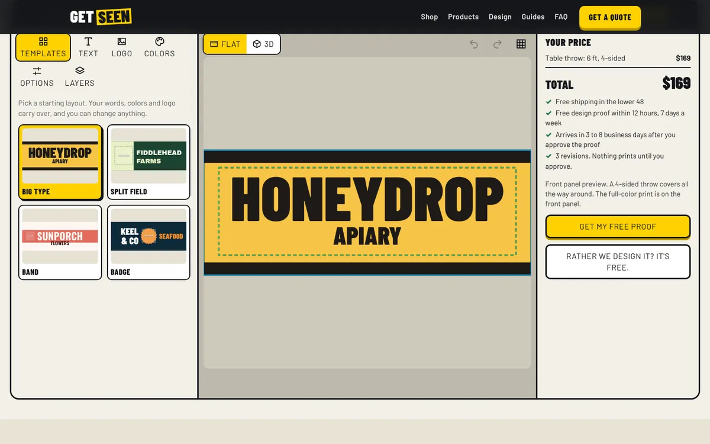 | 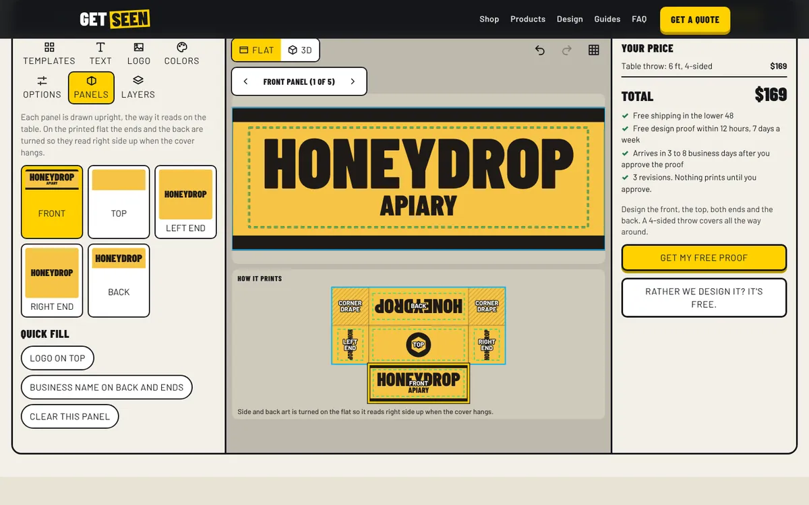 |
| 3D from behind, desktop | 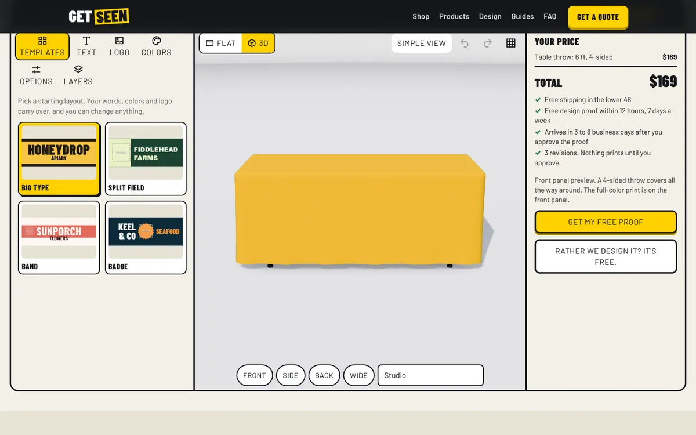 | 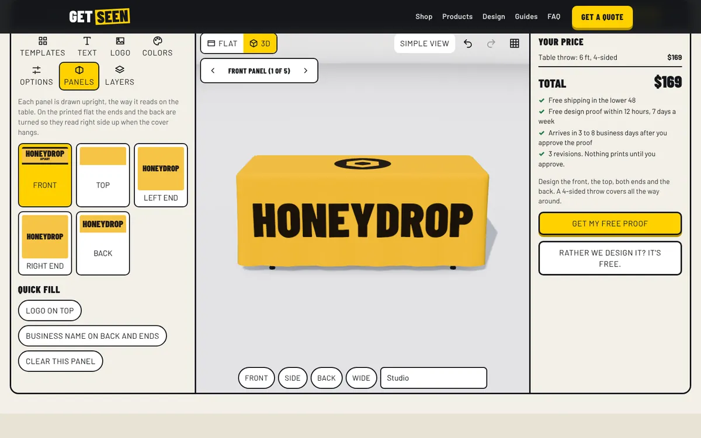 |

| | Before (main) | After, editor | After, Whole flat |
|---|---|---|---|
| Flat view, phone | 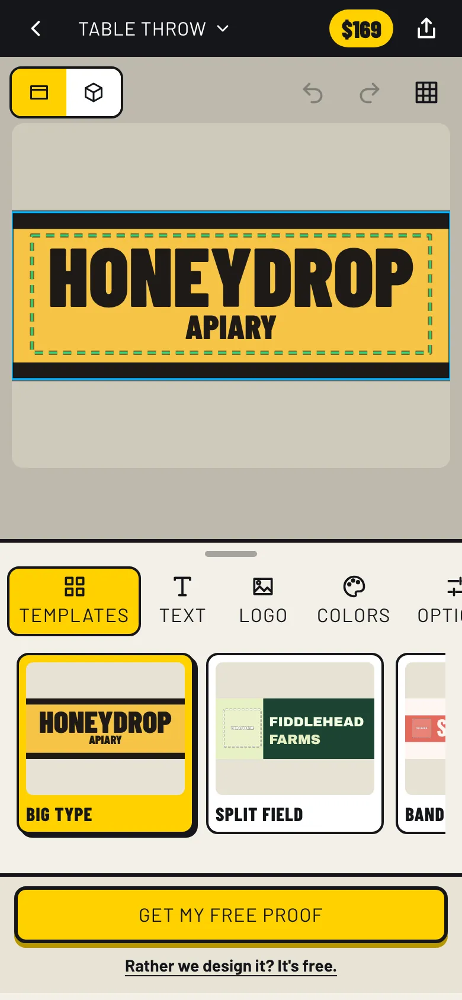 | 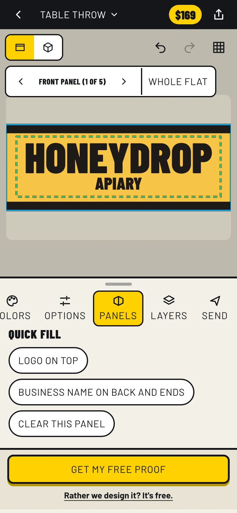 | 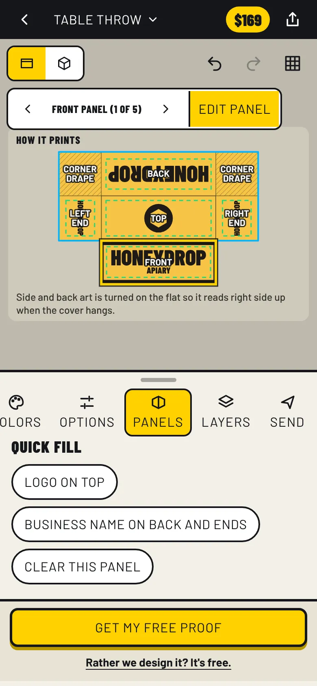 |

| | Before (main) | After |
|---|---|---|
| 3D from behind, phone | 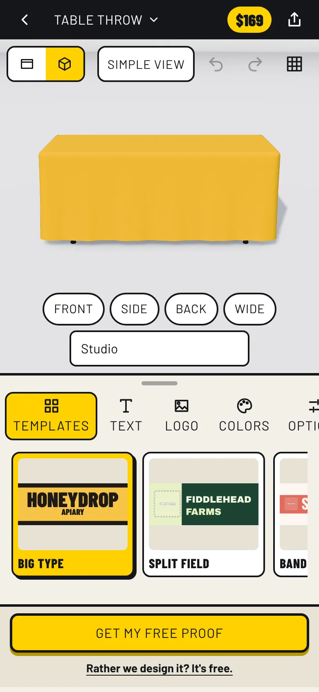 | 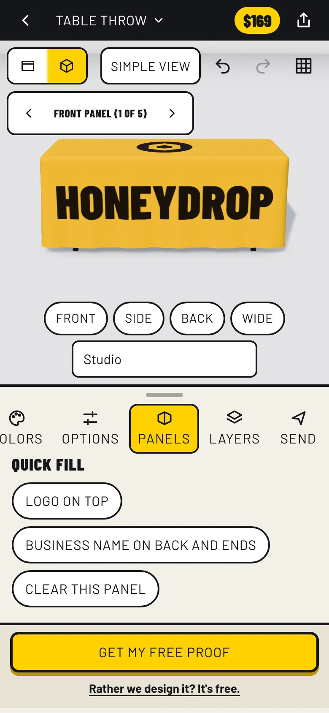 |

## Each panel is edited upright (desktop)

The flat under the editor shows the same art turned for print.

| Top | Left end | Back |
|---|---|---|
| 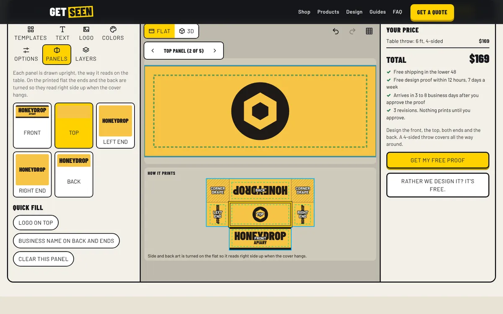 | 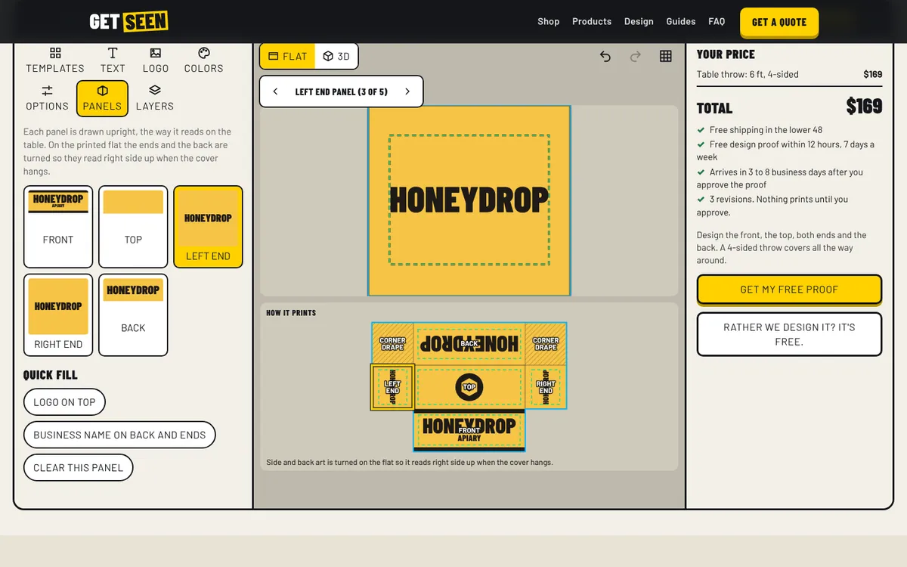 | 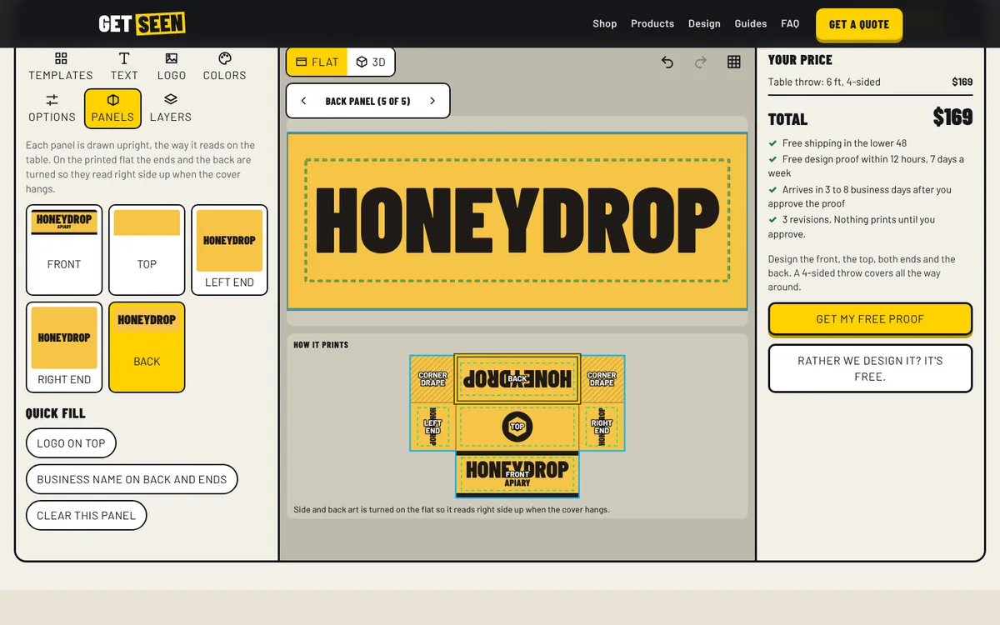 |

## 3D, every face carries its art (desktop)

| Front | Side | Back |
|---|---|---|
| 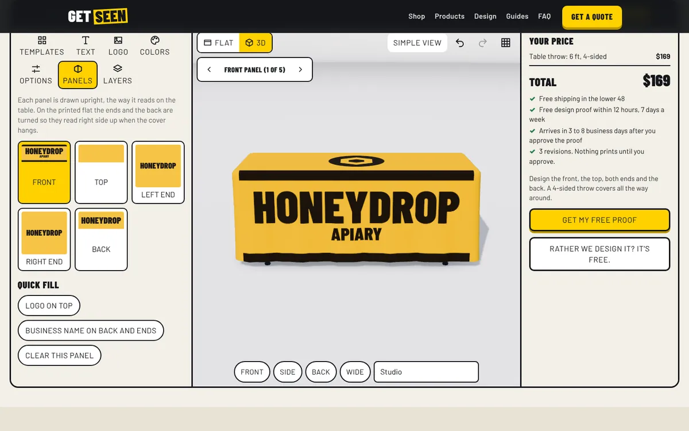 | 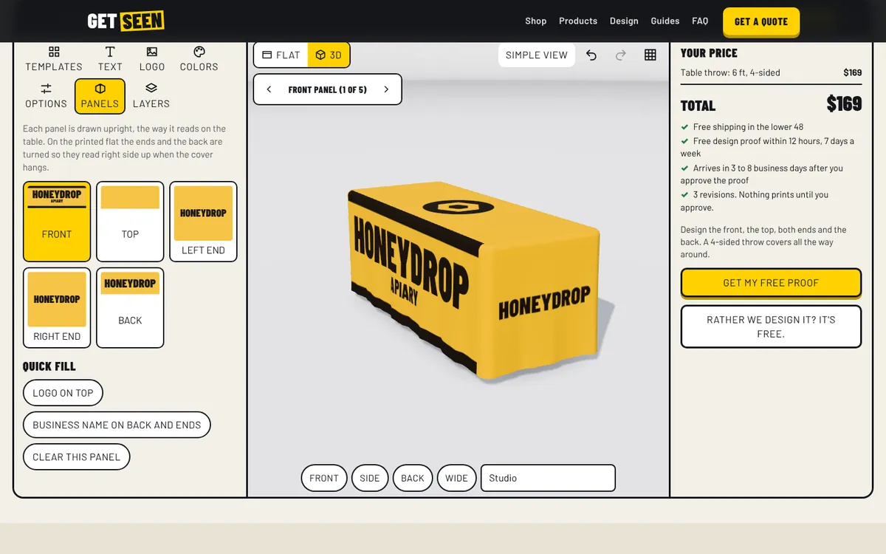 |  |

## 6 ft, 3-sided: open back, plain back strip

| Flat view, desktop | 3D from behind, desktop | Whole flat, phone |
|---|---|---|
| 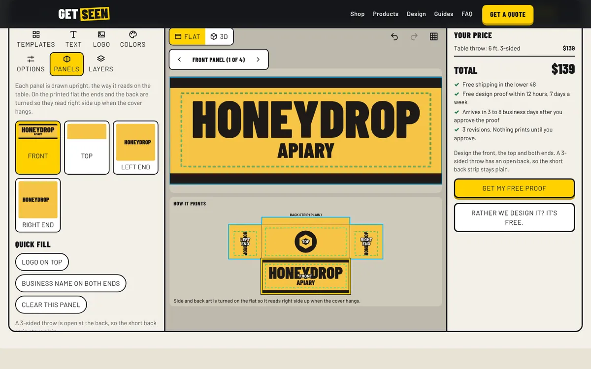 | 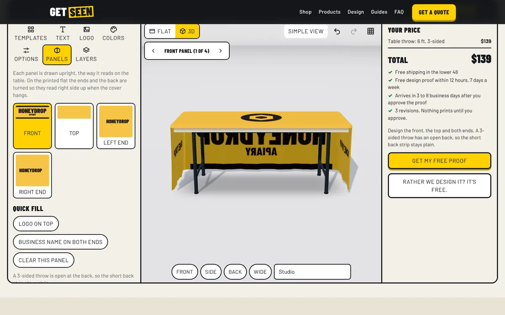 | 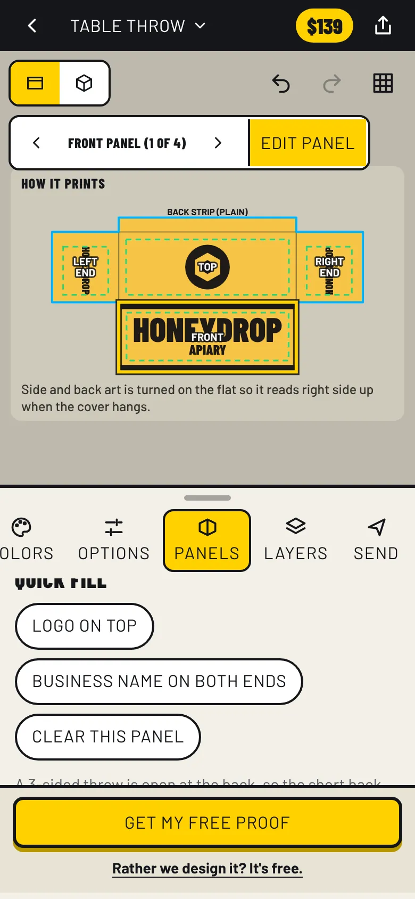 |
